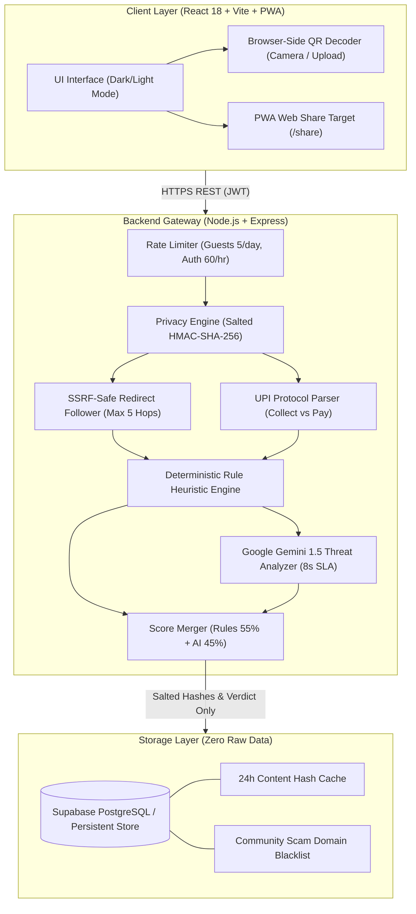

# 🛡️ QR Shield — AI Security, Privacy & Trust

> **"Scan before you trust."**  
> Real-time zero-knowledge threat defense against malicious QR codes, disguised UPI collect scams, phishing links, and social engineering messages (WhatsApp, SMS, Telegram, Email). Built for the **AI Security, Privacy & Trust Hackathon 2026**.

---

## 📌 1. The Problem

Cyber extortion, payment scams, and credential theft are increasingly targeting everyday digital interactions:
- **Quishing (QR Phishing):** Physical stickers pasted over parking meters, restaurant menus, or utility kiosks directing unsuspecting users to credential harvesters.
- **Disguised UPI Fraud:** Fraudulent QR codes generating `upi://collect` debit requests disguised as cashback or refunds. Victims are tricked into entering their PIN to "receive" funds.
- **Urgent KYC & Banking Phishing:** SMS and WhatsApp messages threatening instant account closure, electricity disconnection, or SIM deactivation with fake portal links.
- **Data Harvesting by Existing Security Tools:** Most online link checkers and antivirus uploaders store full URLs (including sensitive auth tokens) and message text in cleartext databases.

---

## 💡 2. The Solution: Zero-Knowledge Dual-Engine Defense

**QR Shield** is an explainable, privacy-first cybersecurity platform that evaluates suspicious items in under two seconds without ever storing private data:
1. **Multi-Vector Security:** Blends **14+ deterministic security heuristic rules (55%)** with **Google Gemini AI threat intelligence (45%)** to detect brand impersonation, typosquatting, zero-day pretexting, and coercive urgency.
2. **Zero-Knowledge Privacy:** Raw URLs, private messages, phone numbers, and camera images are **NEVER stored**. The system operates strictly with salted **HMAC-SHA-256 hashes**.
3. **Radical Transparency:** Every verdict delivers a **0–100 risk score**, a clear verdict badge (`Safe`, `Suspicious`, `Dangerous`), actionable advice, and individual signals tagged `[RULE]` or `[AI]`.

---

## 🏛️ 3. Architecture Diagram



---

## ✨ 4. Key Features

- **📷 Unified QR Scanner:** Live camera scanner with cyberpunk reticle & animated laser scan line, plus image upload drag-and-drop. Decoded entirely inside the browser.
- **💳 Disguised UPI Collect Scam Detector:** Parses `upi://` URI schemes; detects collect requests masquerading as payments, impersonation keywords in payee names, and abnormal amounts.
- **🔗 SSRF-Protected Link Expander:** Recursively follows shortened redirects (bit.ly, tinyurl, etc.) up to 5 hops, blocking loopback, link-local, and private IP spaces.
- **💬 WhatsApp / SMS Message NLP:** Unpacks messages for coercive urgency, digital arrest threats, remote-access app solicitations (AnyDesk, TeamViewer), and OTP/PIN requests.
- **📱 PWA Share-to-Scan (`/share`):** Installable progressive web app featuring a `share_target` in the manifest. Share directly from WhatsApp or Messages into QR Shield.
- **🌐 Safe Link Preview (Air-Gap Sandbox):** Inspects suspicious websites visually in an isolated cloud sandbox without exposing client IP, cookies, or device execution. Protected with DNS resolution anti-SSRF defenses and protocol whitelisting.
- **🛡️ Explainable Verdict Card:** Semicircle animated risk gauge (0–100), verdict badge (`Safe` / `Suspicious` / `Dangerous`), redirect stepper, and dual-tagged signals (`[RULE]` vs `[AI]`).
- **👥 Community Scam Blacklist:** 1-click "Report as scam" adds domain hashes to a crowdsourced blacklist, immediately raising the risk score for future scans.
- **📊 Real-Time Analytics Dashboard:** Interactive Recharts donut charts, 7-day velocity line charts, top threat categories, and personal masked history.
- **🔐 Privacy Center & Right-to-Erasure:** Clear "What We Store vs What We Never Store" breakdown, plus an irreversible "Delete My Data" button.
- **📚 Scam Awareness Guide:** Step-by-step checklists and "Golden Rules" to identify fake UPI QRs, KYC SMS scams, quishing stickers, and job scams.
- **🧪 1-Click Demo Testing:** Four pre-seeded demonstration cards on the Scan page to test all verdict outcomes instantly.

---

## 🛠️ 5. Tech Stack

| Layer | Technologies |
|---|---|
| **Frontend** | React 18, Vite, React Router v6, Tailwind CSS, Recharts, Lucide React, Framer Motion, html5-qrcode |
| **Backend** | Node.js, Express, Zod validation, JWT, bcryptjs, Helmet, CORS, Express-Rate-Limit, Axios |
| **AI Threat Engine** | Google Gemini API (`@google/generative-ai`), backend-only, structured JSON output |
| **Database** | Supabase PostgreSQL (`001_init.sql`) with seamless local persistent store fallback |
| **PWA** | Web App Manifest with Web Share Target API, custom Service Worker |

---

## ⚙️ 6. Environment Variables

### Backend (`server/.env`)
| Variable | Description | Default / Example |
|---|---|---|
| `PORT` | Backend server port | `5000` |
| `NODE_ENV` | Runtime environment | `development` |
| `FRONTEND_URL` | Allowed CORS origin | `http://localhost:5173` |
| `JWT_SECRET` | Secret key for signing JWT tokens | Min 32 random characters |
| `JWT_EXPIRES_IN` | Token expiration period | `1h` |
| `HASH_SALT` | Server-side secret salt for HMAC-SHA-256 | High-entropy secret key |
| `GEMINI_API_KEY` | Google Gemini API Key (Backend only) | `AIzaSy...` |
| `SUPABASE_URL` | Supabase Project URL (Optional) | `https://xyz.supabase.co` |
| `SUPABASE_SERVICE_ROLE_KEY` | Supabase Service Role Key (Optional) | `eyJ...` |

*(Note: If Supabase credentials are left blank, QR Shield automatically switches to a robust local persistent JSON store so the app functions out-of-the-box!)*

### Frontend (`client/.env`)
| Variable | Description | Default / Example |
|---|---|---|
| `VITE_API_URL` | Backend API base URL | Leave blank to use Vite dev proxy `/api` |

---

## 🚀 7. Quickstart Setup Guide

### Prerequisites
- Node.js v18+ (tested on Node v20/v24)
- npm v9+

### 1. Clone the repository
```bash
git clone https://github.com/prajwalmantur17-collab/QR-SHIELD.git
cd QR-SHIELD
```

### 2. Configure Environment Files
- Server environment:
  ```bash
  cp server/.env.example server/.env
  ```
  *(Add your `GEMINI_API_KEY` to `server/.env` for Gemini neural reasoning, or run with the deterministic rule engine).*

- Client environment:
  ```bash
  cp client/.env.example client/.env
  ```

### 3. Install Dependencies
```bash
# Install backend packages
cd server
npm install

# Install frontend packages
cd ../client
npm install
```

### 4. Seed Database (Demo User, Community Blacklist & Scans)
```bash
cd ../server
npm run seed
```
*Seeded Demo Account:*
- **Email:** `demo@qrshield.sec`
- **Password:** `ShieldSecure2026!`

### 5. Launch the Application
Run in two terminal windows:

**Terminal 1 (Backend Server):**
```bash
cd server
npm run dev
# Server listens on http://localhost:5000
```

**Terminal 2 (Frontend Client):**
```bash
cd client
npm run dev
# App opens at http://localhost:5173
```

---

## 📡 8. REST API Reference

All requests and responses use JSON with Zod schema validation:

| Method | Endpoint | Auth | Description |
|---|---|---|---|
| `GET` | `/api/health` | Public | Server uptime and health probe |
| `POST` | `/api/auth/register` | Public (Rate limited) | Register new user account |
| `POST` | `/api/auth/login` | Public (Rate limited) | Authenticate user & issue JWT |
| `GET` | `/api/auth/me` | Bearer JWT | Retrieve current profile |
| `DELETE`| `/api/me/data` | Bearer JWT | Permanently purge account & history |
| `POST` | `/api/scan/link` | Optional Auth | Scan & expand URL safely |
| `POST` | `/api/scan/qr` | Optional Auth | Scan QR code (UPI, link, or text) |
| `POST` | `/api/scan/message` | Optional Auth | Scan WhatsApp / SMS message |
| `POST` | `/api/preview` | Optional Auth | Generate isolated SSRF-protected visual preview |
| `POST` | `/api/report` | Optional Auth | Flag malicious domain to blacklist |
| `GET` | `/api/stats` | Optional Auth | Telemetry counts, donut data & time-series |
| `GET` | `/api/history` | Bearer JWT | Masked scan history for user |

---

## 🔒 9. Zero-Knowledge Privacy Design

```
Raw Input (e.g. "http://bank-kyc.xyz?token=secret")
                     │
                     ▼
          [ HMAC-SHA-256 Engine ] ◄── Server Salt (Secret)
                     │
                     ▼
  Salted Hash: "eb13227d58f186f54e162cc514c7153c..."
                     │
         ┌───────────┴───────────┐
         ▼                       ▼
  Database Record         Memory Purge
  (Hash + Verdict only)   (Raw URL immediately wiped)
```
- **Rainbow Table Resistant:** Standard SHA-256 of predictable links can be cracked via rainbow tables. QR Shield uses **keyed HMAC with a secret server salt**, ensuring hashes cannot be reversed even if the database leaks.
- **In-Memory Masking:** Phone numbers (`+91 98****3210`), emails (`al***x@domain`), and 6-digit OTP codes are masked before passing to Gemini AI.
- **Client-Side Decoding:** Camera video streams and uploaded QR images never leave your browser.

---

## ☁️ 10. Deployment Instructions

### Frontend on Vercel
1. Link your repository on [Vercel](https://vercel.com).
2. Set Root Directory to `client`.
3. Set Build Command to `npm run build` and Output Directory to `dist`.
4. Configure Environment Variable: `VITE_API_URL=https://your-backend.onrender.com`.

### Backend on Render
1. Create a **Web Service** on [Render](https://render.com).
2. Set Root Directory to `server`.
3. Set Build Command to `npm install` and Start Command to `npm start`.
4. Add Environment Variables: `PORT=5000`, `FRONTEND_URL=https://your-app.vercel.app`, `HASH_SALT=...`, `JWT_SECRET=...`, `GEMINI_API_KEY=...`.

### Database on Supabase
1. Create a new PostgreSQL project on [Supabase](https://supabase.com).
2. Navigate to the SQL Editor.
3. Paste and run the contents of [`supabase/migrations/001_init.sql`](supabase/migrations/001_init.sql).
4. Copy `Project URL` and `service_role` secret key into your backend environment.

---

## 🎬 11. Demonstration Walkthrough & Video Script

### 3-Minute Live Demo Walkthrough (for Hackathon Video)

1. **Introduction (0:00 - 0:45):**
   - Introduce **QR Shield**: An AI-powered zero-knowledge security, privacy & trust platform.
   - Explain the problem: Quishing (QR phishing), deceptive `upi://collect` fraud, and urgency-laden social engineering SMS/WhatsApp attacks.
   - Highlight the design standard: Enterprise light-mode interface inspired by Stripe, Linear, and Vercel.

2. **Core Feature 1: Real-Time URL & Threat Intelligence (0:45 - 1:30):**
   - Navigate to `/scan` and select the **URL Scanner** tab.
   - Paste a suspicious or typosquatted link (e.g., `http://paytm-security-alert.top/verify`).
   - Click **Scan URL**.
   - Show the dynamic progress analysis: SSRF-safe link expander → 14 deterministic heuristics → Google Gemini neural threat classification.
   - Showcase the explainable **Verdict Card**: Semicircle Risk Gauge (100/100 Dangerous), dual-engine signal tags (`[RULE]` Brand Impersonation, `[AI]` Phishing Pretext), and plain-English actionable recommendations.

3. **Core Feature 2: Camera & QR Code Scanning (1:30 - 2:05):**
   - Switch to the **QR Code** tab.
   - Demonstrate camera activation or drag-and-drop of a QR code image.
   - Explain client-side decoding: the image is decoded directly inside the browser using HTML5 Canvas/Wasm, never sent to any server.
   - Show instant parsing of UPI strings (`upi://pay` vs `upi://collect`), warning users immediately if a QR is requesting money rather than sending funds.

4. **Core Feature 3: WhatsApp / SMS Message Analysis (2:05 - 2:35):**
   - Switch to the **Message Scanner** tab.
   - Paste a fraudulent alert (e.g., *"Dear Customer, your electricity will be disconnected tonight at 9:30 PM due to unpaid bill. Call 9876543210 immediately"*).
   - Observe live Gemini AI detection of coercive urgency, fake authority pretexting, and phone number harvesting.

5. **Privacy Center & Dashboard (2:35 - 3:00):**
   - Navigate to `/privacy`: Show the "What We Store / What We Never Store" breakdown. Demonstrate HMAC-SHA-256 salted hashing and the **Right-to-Erasure (Delete My Data)** guarantee.
   - Visit `/dashboard`: Showcase real-time telemetry, threat distribution charts, and velocity time-series powered by Supabase PostgreSQL.

---

## 🏆 12. Hackathon Compliance Checklist

| Requirement | QR Shield Implementation | Status |
|---|---|---|
| **Theme: AI Security, Privacy & Trust** | Identifies threats, protects user privacy (HMAC zero-knowledge), and builds trust with explainable AI | ✅ Complete |
| **Frontend Stack** | React 18, Vite, React Router v6, Tailwind CSS, Recharts, Lucide Icons | ✅ Complete |
| **Backend Stack** | Node.js, Express, JWT, bcryptjs, Zod schema validation, Helmet, CORS | ✅ Complete |
| **Database** | Supabase PostgreSQL (`public.scans`, `public.users`, `public.community_reports`) | ✅ Complete |
| **AI Integration** | Google Gemini API (`gemini-3.5-flash-lite`), backend environment variables only | ✅ Complete |
| **Source Code & Setup** | Public GitHub repository with clean architecture & full setup guide | ✅ Complete |
| **Privacy Guarantee** | Zero raw storage of URLs/messages; camera stream decoded in-browser | ✅ Complete |

---

## 📄 License
MIT License. Built with ❤️ for the **AI Security, Privacy & Trust Hackathon 2026**.
